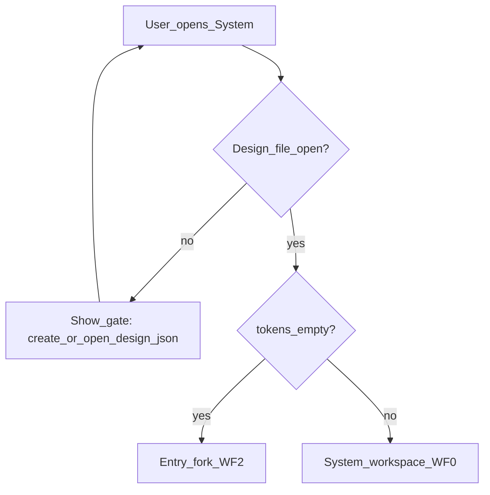
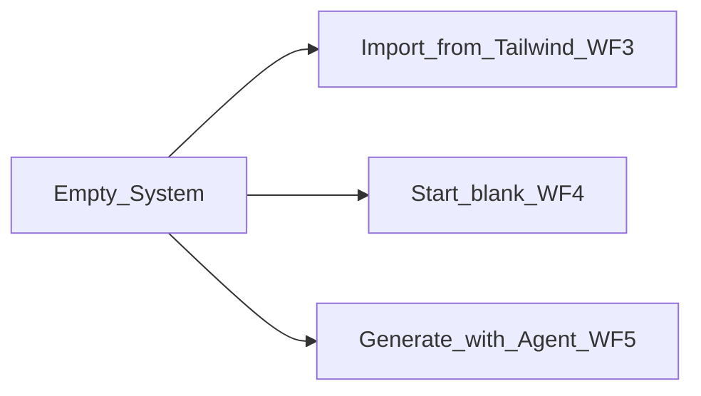
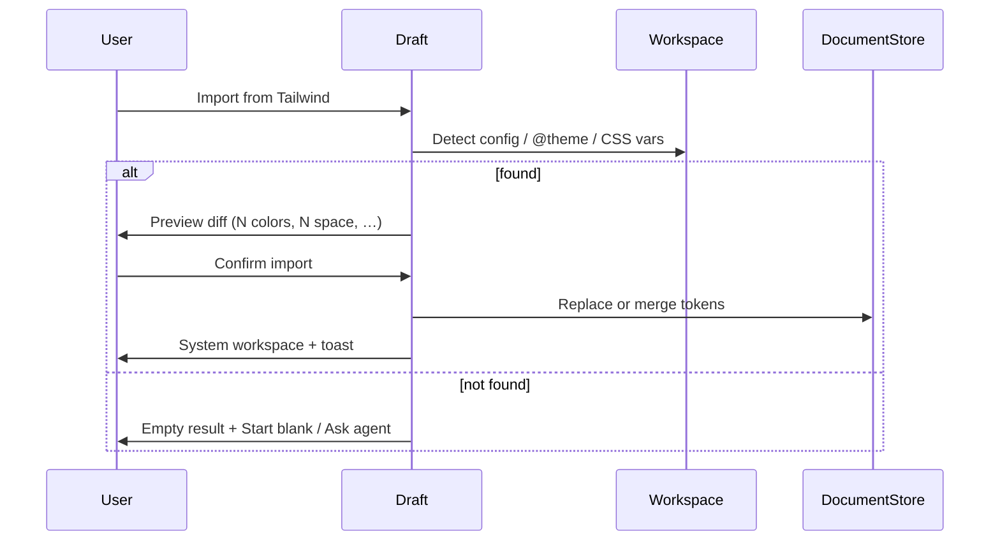
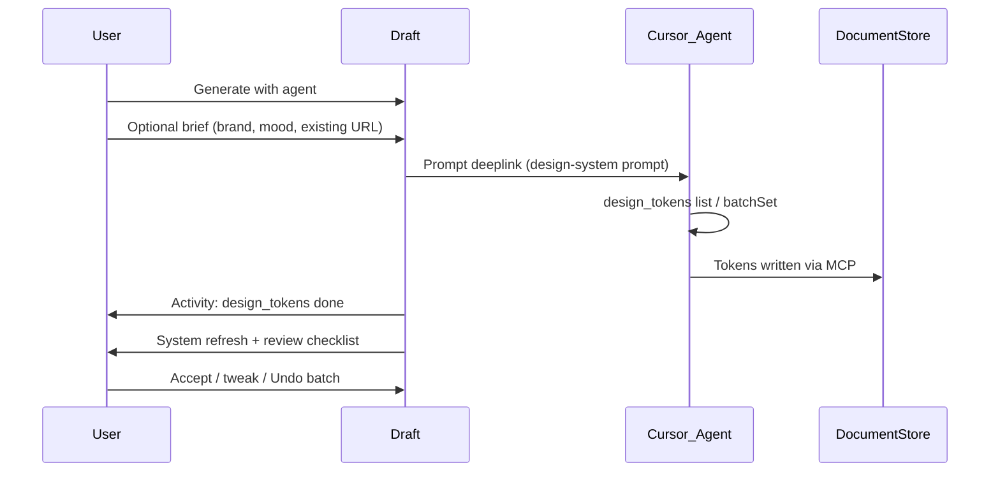
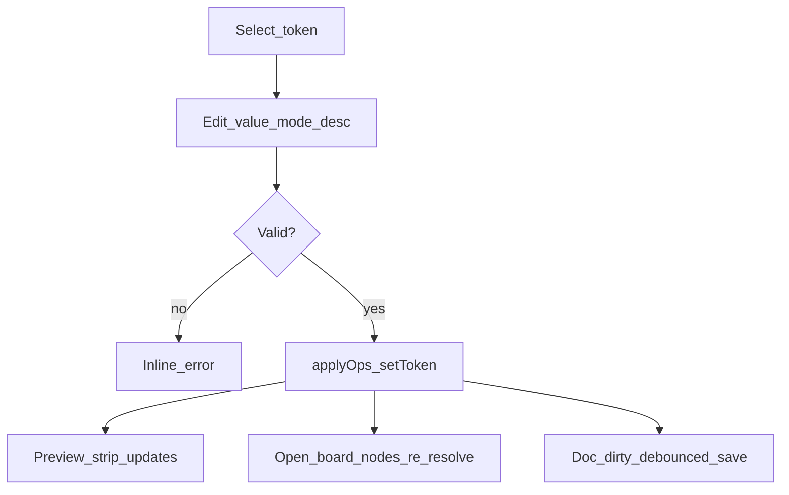
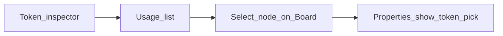
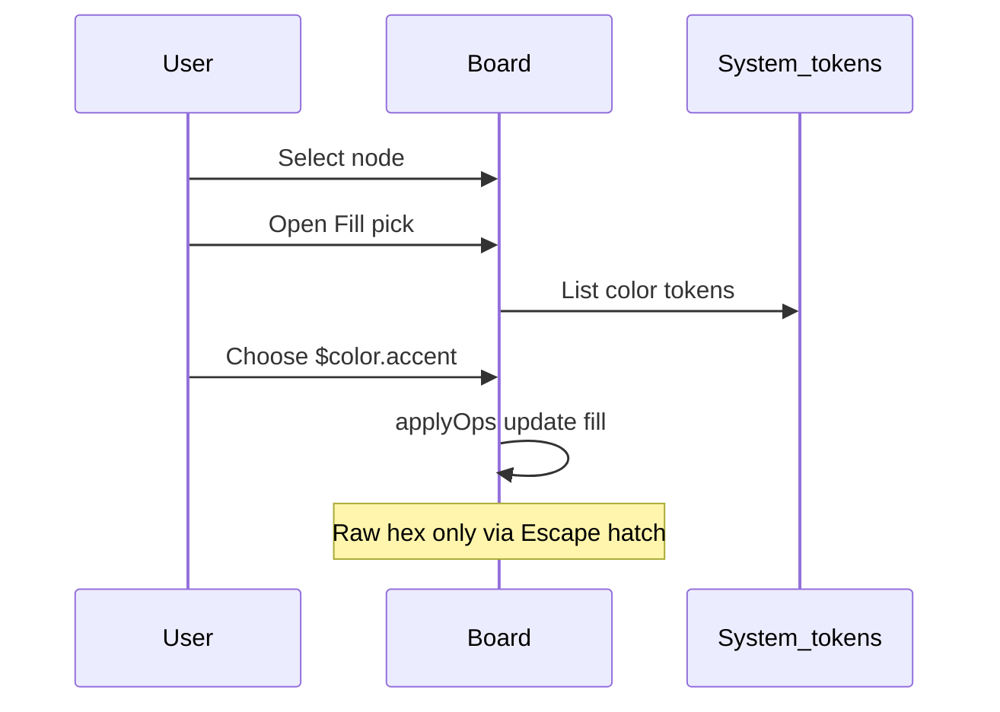
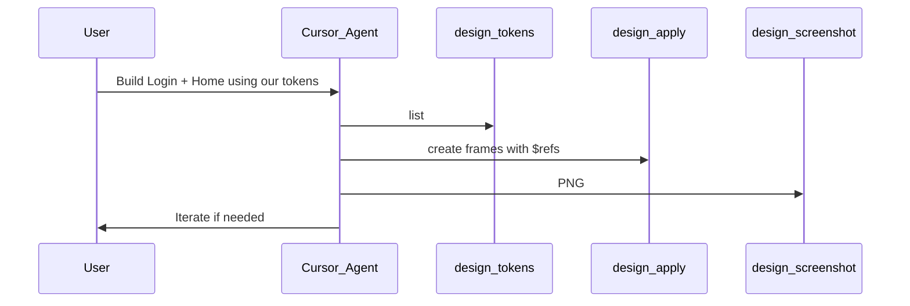
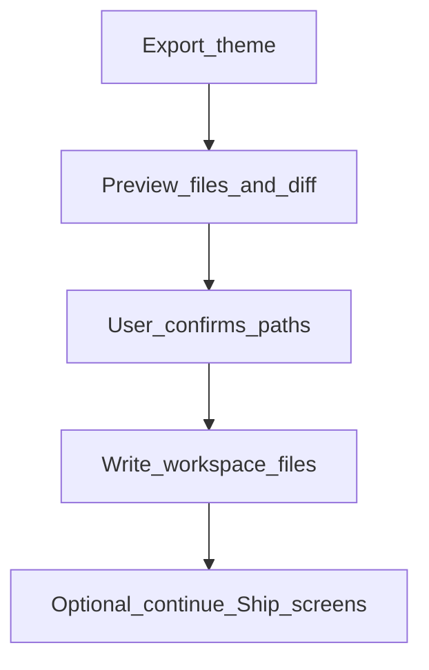

# System feature — full workflows

*Draft UX/product workflows for Draft’s design-system surface. Actors: **User** (designer/dev in Cursor), **Agent** (Cursor agent via MCP), **Draft** (extension UI + DocumentStore).*

System owns the project’s `tokens` table in `*.design.json`. Screens and components only *reference* `$token` names. Shipping writes theme artifacts into the repo alongside screens.

---

## 0. Concepts

| Term | Meaning |
|---|---|
| **Token** | Named value: `color.accent`, `space.4`, `type.display`, `radius.md`, … |
| **Role** | Semantic label shown in UI (Background, Accent, Danger) mapped 1:1 to a token |
| **Alias** | Optional: one token points at another (`color.cta` → `color.accent`) |
| **Mode** | Light / dark value pair on color (and later elevation) tokens |
| **Usage** | Frames/nodes that reference a token via fill, gap, font, radius, etc. |
| **Theme sync** | Bidirectional bridge to `tailwind.config` / `@theme` / `tokens.css` |

**Hard rules**

1. Agent must `design_tokens` (list/get/set) before inventing colors/spacing/type in `design_apply`.
2. Board properties are token-first; raw hex/px is an escape hatch (marks node `untokenized`).
3. One agent handoff from Draft: **Send to Cursor** (prompt deeplink). System does not embed chat.
4. Renames/deletes are refactors: update all `$refs` or block with usage list.

---

## 1. Entry: open System



**UI:** System route/panel. If no doc → same empty-state as Board (create `app.design.json`). If tokens empty → **Entry fork** (WF2). Else → **System workspace** (browse/edit).

**Success:** User sees foundations for the active design file; file name visible in chrome.

---

## 2. Entry fork (empty system)

**Goal:** Choose how the first token set is created.



| Option | Primary CTA | When |
|---|---|---|
| **Import from Tailwind** | “Scan workspace theme” | Repo already has `tailwind.config` / `@theme` |
| **Start blank** | “Add color roles” | Greenfield brand |
| **Generate with agent** | “Send to Cursor” | User wants a proposed system from a brief |

**Copy principle:** three equal cards; no dead buttons. Import disabled only if no config found (with explanation).

---

## 3. Import from Tailwind / `@theme`

**Actors:** User · Draft · (optional) Agent for conflict review  
**MCP:** `design_tokens({ action: "fromTailwind", path? })`



### Steps
1. User clicks **Import from Tailwind**.
2. Draft scans known paths (`tailwind.config.*`, `src/**/*.css` `@theme`, `tokens.css`).
3. **Preview panel:** mapped tokens, unmapped keys, collisions with existing doc tokens.
4. User chooses **Replace all** or **Merge (keep doc on conflict)**.
5. Confirm → `fromTailwind` applied → DocumentStore → debounced save.
6. Toast: “Imported 12 tokens from tailwind.config.ts”.
7. CTA: **Continue to Board** or stay to edit.

### Errors
| Case | Handling |
|---|---|
| No config | Explain + offer Blank / Agent |
| Parse failure | Show path + error; do not partial-write |
| Merge conflicts | List side-by-side; user picks per-token |

### Success
Doc.tokens populated; usages still 0 until Board; Ship later can `toTailwind` / `exportTheme`.

---

## 4. Start blank (seed minimal roles)

**Goal:** Human-authored starter set without agent.

### Default seed (suggested)
- Color roles: Background, Foreground, Accent, Muted, Danger  
- Space: `space.2`, `space.4`, `space.6`  
- Type: `type.display`, `type.body`  
- Radius: `radius.md`

### Steps
1. User chooses **Start blank**.
2. Draft creates seed tokens with placeholder values (or empty values requiring fill).
3. System workspace opens with **Color roles** in edit mode on first incomplete token.
4. User sets values (light required; dark optional).
5. Live preview strip updates (button / text / field).
6. Gate: **Continue to Board** enabled when ≥1 color + ≥1 space exist.

### Success
Minimal viable system; agent SKILL treats missing groups as “extend before use.”

---

## 5. Generate system with Agent

**Goal:** Agent proposes tokens from a brief **and builds a first screen on them** (default); User confirms into the doc. Tokens-only is the opt-out.

**Handoff:** Single **Send to Cursor** deeplink (no in-app chat).  
**MCP:** `design_tokens` batchSet · optionally screenshot of preview strip later.



### Prompt template (deeplink body)
```
Create a design system in the open *.design.json for <brief>.
1) design_tokens list
2) design_tokens batchSet for color roles, space scale, type, radius
3) Then build the first screen from the brief on those tokens (design_apply → design_screenshot); tokens only if I say so
4) Prefer semantic names ($color.bg, $color.accent, …)
```

### Steps
1. User opens Generate card → optional brief field → **Send to Cursor**.
2. Status on annotation/system: `sent`.
3. Activity rail (if open on Board) or System banner: tool rows for `design_tokens`.
4. On store change, System re-renders; the first screen appears on the Board (active page).
5. User reviews: Accept all · Edit roles · **Undo** (inverse ops).

### Errors
| Case | Handling |
|---|---|
| User never sends chat | Banner: “Prompt ready — press Send in Cursor” |
| User asked tokens-only but agent built screens | Toast + link to Board; tokens still valid; Undo removes the frames |
| Invalid token payload | Validation errors; no partial commit (atomic batch) |

---

## 6. Browse System workspace

**Goal:** Understand and navigate foundations.

### Layout (target)
- Left/main: groups — Color roles · Space · Type · Radius · (Shadow later)
- Persistent **preview strip**: sample button, text, input using current tokens
- Right or inline: selected token inspector
- Header: Import · Export theme · Ask agent to extend · Continue to Board

### Interactions
- Filter by group; search by name/role
- Click row → inspector (value, dark, description, usage count)
- Click usage count → WF11

---

## 7. Edit token / role

**Actors:** User (UI) or Agent (`design_tokens` set / `setToken` op)  
**Ops:** `{ op: "setToken", name, token }`



### Steps (UI)
1. Select token → inspector.
2. Change light value (color picker / number / font fields).
3. Optional dark value; optional description.
4. Blur/Enter commits (or explicit Save if batching).
5. Preview strip + any open Board views re-resolve `$refs`.
6. If token used on Board, subtle “N surfaces updated” toast.

### Agent path
`design_tokens({ action: "set", name, token })` or `batchSet` → same reducer.

### Errors
- Invalid color / NaN → block commit  
- Circular alias → block with message  

---

## 8. Add token

### Steps
1. **Add** in a group (or “Add role”).
2. Name slug validated (`color.*` pattern); role label optional.
3. Required fields by type (`color` → value; `number` → value; `font` → family/size/weight).
4. Commit → appears in list; usage 0.
5. Optional: “Use on selection” if Board has selection (sets fill/gap/etc. to new `$name`).

### Agent
`batchSet` with new keys; SKILL prefers extending groups over one-off hex in nodes.

---

## 9. Rename token

**Goal:** Rename without breaking screens.

### Steps
1. Rename in inspector.
2. Draft scans usages (`$old` in nodes).
3. Dialog: “Rename `color.accent` → `color.brand` in N nodes?”
4. Confirm → token map key change + rewrite all refs in one atomic batch.
5. Toast with Undo.

### Block
If name collides with existing token → error.

---

## 10. Delete token

### Steps
1. Delete action.
2. If usage = 0 → confirm soft delete.
3. If usage > 0 → **block** with list of nodes + options:
   - Replace refs with another token, then delete  
   - Convert refs to raw (escape hatch) + delete  
   - Cancel  
4. Atomic batch; Undo available.

### Agent
`delete` / `setToken null` must follow same usage rules; return errors listing node ids.

---

## 11. Where-used → jump to Board



### Steps
1. User opens usage on token (e.g. “Accent · 2”).
2. List: `fr_login / bt_submit · fill`, `fr_home / cta · fill`.
3. Click row → open Board (same doc), `design_select` equivalent, scroll into view.
4. Properties highlights the bound token pick.

### Empty
“Not used yet” → CTA **Continue to Board** / **Ask agent to build a screen using these tokens**.

---

## 12. Use tokens on the Board (token-first properties)

**Goal:** Bind node styles to System without leaving craft flow.



### Steps
1. Select node → Properties → Fill / Gap / Type / Radius.
2. Token picker lists group-filtered tokens + search.
3. Choose `$color.accent` → node stores ref string, not resolved hex (resolve at render).
4. **Escape hatch:** “Custom value…” → stores raw; badge **Untokenized** on layer row.
5. Changing token in System (WF7) updates all bound nodes live.

### Agent
`design_apply` must set `"fill": "$color.accent"` etc. SKILL forbids raw unless user asked.

---

## 13. Agent builds screens on the system

**Prerequisite:** Non-empty tokens (or agent creates them first — WF5).



### Steps
1. User on Board (or after System Continue) prompts agent.
2. Agent: `design_tokens` list → `design_apply` → `design_screenshot`.
3. Activity rail shows tool rows.
4. User reviews visually; may annotate (Review journey) with token-aware notes.

### Failure
If tokens empty, agent runs WF5-equivalent batchSet first, then apply (SKILL-mandated).

---

## 14. Ask agent to extend the system

**From System header:** “Ask agent to extend”

### Steps
1. User optional note: “Add warning color and denser space scale.”
2. **Send to Cursor** with `design-system` prompt + current token summary.
3. Agent `batchSet` additions only (prefer non-destructive).
4. System highlights new rows; user Accept / Undo.

---

## 15. Export theme (`exportTheme` / `toTailwind`)

**Goal:** Design system becomes repo artifacts (Ship step or System action).

| Format | Output |
|---|---|
| `css-vars` | `src/theme/tokens.css` (`--color-accent: …`) |
| `tailwind-v4` | `@theme { … }` block / file |
| `json` | `tokens.json` dump |
| `toTailwind` | Patch `tailwind.config.*` |



### Steps
1. User clicks **Export theme** (System) or reaches **Ship**.
2. Preview paths + diff (agent path: `exportTheme` without `confirm` returns this same preview).
3. Confirm → write files via `WorkspaceEdit` (agent path: `confirm: true`).
4. Toast with paths; optional open file in editor.
5. Ship journey can include screens export in same session.

### Conflicts
If target file hand-edited, show merge/overwrite dialog (never silent clobber without preview).

---

## 16. Re-import / drift reconciliation

**Goal:** Code theme and doc.tokens diverge (common in real teams).

### Steps
1. Draft detects drift (hash of last sync vs current config) on System open or command.
2. Banner: “Theme in repo differs from Design tokens.”
3. Actions: **Pull from Tailwind** (WF3 merge) · **Push to Tailwind** (WF15) · Dismiss.
4. Optional Agent: “Reconcile drift” deeplink summarizing both sides.

---

## 17. Light / dark modes

### Steps
1. Color token supports `value` + `dark`.
2. System preview toggle: Light | Dark.
3. Board device preview respects document `mode` or page-level preference.
4. Export emits both (e.g. `.dark { --color-bg: … }`).
5. Missing `dark` → fall back to light with warning in inspector.

---

## 18. Components built on tokens (Phase 2 touchpoint)

Not full System MVP, but workflow boundary:

1. Component styles reference tokens only.
2. Changing `$color.accent` updates all instances.
3. System usage includes component defs + instances.
4. Agent creates components after tokens exist.

---

## 19. Journey mapping (first 10 minutes)

| Journey step | System workflows involved |
|---|---|
| 01 Welcome | — (promise System first) |
| 02 System | WF1 → WF2 → (WF3 \| WF4 \| WF5) → WF6 |
| 03 Board | WF12 · WF13 |
| 04 Review | Token-aware annotation notes; agent may WF7/WF8 |
| 05 Ship | WF15 (+ screen export) |

---

## 20. MCP / op cheat sheet

| Workflow | Primary API |
|---|---|
| Import | `design_tokens.fromTailwind` |
| Generate / edit / add | `design_tokens.batchSet` / `set` · op `setToken` |
| Delete | `design_tokens.delete` · op `setToken` null |
| List / where-used | `design_tokens.list` + doc scan · resource `design://…/tokens` |
| Export | `design_tokens.exportTheme` / `toTailwind` (preview → `confirm: true`) |
| Board bind | `design_apply` with `$refs` |
| Agent verify | `design_screenshot` |

---

## 21. Acceptance criteria (System feature done)

- [ ] Empty doc shows entry fork (Import / Blank / Agent) — no dead CTAs  
- [ ] User can edit color + space tokens; Board picks update live  
- [ ] Rename/delete guarded by usage  
- [ ] Agent can batchSet tokens then build a screen with only `$refs`  
- [ ] Export theme writes a file the app can consume  
- [ ] Drift banner appears when repo theme ≠ doc after sync  
- [ ] Generate / extend use **Send to Cursor** only  

---

## 22. Out of scope (for these workflows)

- Multiplayer editing of tokens  
- Figma Variables import (Later)  
- Full Style Dictionary pipelines  
- Collaborative comment threads on tokens  

---

## 23. Mockup map (implemented)

| Workflow | Mockup route |
|---|---|
| WF2 Entry fork | `#/system` |
| WF3 Import | `#/system/import` |
| WF4 Blank seed | `#/system/workspace?seed=blank` |
| WF5 Generate | `#/system/generate` |
| WF6–11 Workspace | `#/system/workspace` (edit, usage, delete block) |
| WF15 Export theme | `#/system/export` |
| WF12–13 Board bind / agent | `#/board`, `#/board/live` (board shows one page at a time; folders → pages → frames) |

*Related: [PLAN.md](../PLAN.md) §2.2 · §3.5 `design_tokens` · [mockups/README.md](../mockups/README.md).*
